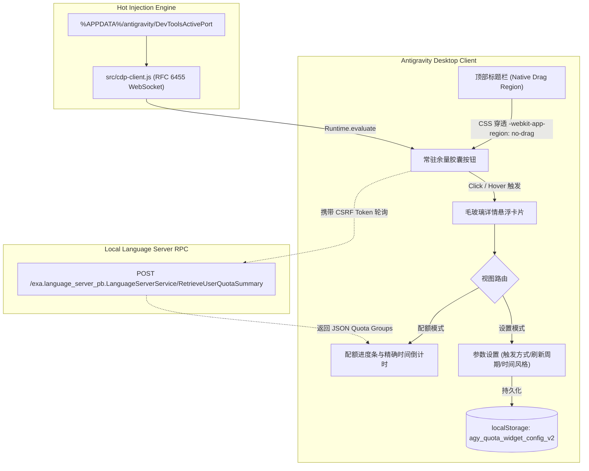

# ⚡ Antigravity Model Quota Indicator

<p align="center">
  <strong>Google Antigravity 桌面客户端工作区实时模型配额与用量监控插件</strong><br>
  <em>Real-Time AI Model Quota Monitor & Indicator Widget for Google Antigravity Desktop Client</em>
</p>

<p align="center">
  <a href="https://github.com/Sliccic/antigravity-quota-indicator/blob/main/LICENSE"></a>
  <a href="https://nodejs.org/"></a>
  <a href="https://github.com/Sliccic/antigravity-quota-indicator"></a>
  <a href="https://github.com/Sliccic/antigravity-quota-indicator/stargazers"></a>
</p>

---

## 📖 痛点与简介 (Introduction)

在使用 **Google Antigravity (反重力)** 桌面客户端进行高强度 AI 配对编程时，我们经常需要关注当前模型的额度消耗与冷却时间。但在官方客户端中：
- 每次查看配额都必须手动点击左下角 **Settings ⚙️ -> Models & Usage -> Quotas**，步骤繁琐且打断编程心流；
- 无法在主工作界面直观感知 5 小时限额与 7 天周限额何时刷新。

**Antigravity Model Quota Indicator** 是一个专为 Google Antigravity 客户端打造的轻量级无侵入实时插件：
- **常驻标题栏胶囊**：在界面顶部非阻塞展示 Gemini 5h 与周限额百分比；
- **毛玻璃悬浮卡片**：展示所有模型（Gemini / Claude / GPT）详细进度条与精确到 `？小时？分钟` / `？天？小时` 的重置倒计时；
- **卡片内置设置中心**：自由配置单击/悬停触发、刷新频率、中英文时间显示风格；
- **零重启热注入**：借助 Chrome DevTools 协议，无需重启客户端即可 1 秒热生效！

---

## 🖼️ 界面效果预览 (Screenshots)

### 1. 配额用量卡片主视图 (Quota View)
支持实时查看 Gemini 共享池与 Claude/GPT 第三方模型的 5 小时限额与周限额进度，并精准计算倒计时：


### 2. 插件参数设置视图 (Settings View)
卡片内置 `⚙️ 设置` 界面，支持个性化定制并持久保存到本地存储：


---

## ✨ 核心特性 (Features)

| 特性 | 说明 |
| :--- | :--- |
| 🏷️ **标题栏常驻胶囊** | 吸附于客户端顶部导航栏，带动态状态指示灯（🟢 健康 / 🟡 预警 / 🔴 见底），完全不污染聊天输入框与工作区。 |
| ⏳ **精确倒计时计算** | 5 小时限额精准格式化为 **`？小时？分钟`**（如 `4小时28分钟`）；7 天限额显示为 **`？天？小时`**（如 `5天22小时`）。 |
| ⚙️ **内置设置菜单** | 卡片内置独立设置视图，支持一键切换触发方式、自动刷新周期与中英文风格。 |
| 👆 **灵活触发方式** | 支持在设置中随时切换：**单击展开/收起** 或 **鼠标悬停预览**（悬停时支持单击常开固定）。 |
| ⏱️ **自由刷新周期** | 支持自选：30 秒 / 60 秒 (推荐默认) / 2 分钟 / 5 分钟，或关闭自动仅保留手动刷新。 |
| 🌐 **中英双语风格** | 限额倒计时支持一键切换为中文（`4小时28分钟 · 5天22小时`）或英文（`4h 28m · 5d 22h`）。 |
| ⚡ **零重启即时热加载** | 原生 RFC 6455 纯 Node.js CDP 协议客户端，1 秒内直接向活跃窗口热打补丁，无需打断当前开发。 |
| 🛡️ **更新自愈与原子暂存** | 客户端运行中自动打包为 `app.asar.staged`，关闭时通过后台守候 0.5 秒原子替换，解决文件锁占用问题。 |

---

## 🚀 快速上手 (Quick Start)

### 方式一：Windows 一键快速运行（推荐）

1. 克隆或下载本项目到本地：
   ```bash
   git clone https://github.com/Sliccic/antigravity-quota-indicator.git
   cd antigravity-quota-indicator
   ```
2. **零重启即时热生效**（推荐）：
   - 双击运行 **`hot-reload.bat`**
   - 脚本将自动连接当前打开的 Antigravity 窗口并在 1 秒内激活插件！
3. **永久安装到客户端资源包**：
   - 双击运行 **`install.bat`**
   - 自动备份出厂 ASAR，并在客户端关闭时自动完成持久化安装。

---

### 方式二：Node.js CLI 命令行

确保机器上已安装 Node.js (>= 16.0)：

```bash
# 1. 克隆仓库
git clone https://github.com/Sliccic/antigravity-quota-indicator.git
cd antigravity-quota-indicator

# 2. 零重启热加载（即时生效到当前运行窗口）
node bin/cli.js hot-reload

# 3. 永久打补丁安装
node bin/cli.js install

# 4. 如需一键卸载复原官方纯净原版
node bin/cli.js restore
```

---

### 方式三：浏览器控制台手动执行 (DevTools)

如果您希望不修改任何本地文件直接体验：
1. 在 Antigravity 客户端按快捷键 `Ctrl + Shift + I`（macOS 为 `Cmd + Option + I`）打开 DevTools 控制台；
2. 复制并粘贴 [`src/quota-widget.js`](src/quota-widget.js) 中的完整代码并回车；
3. 标题栏常驻胶囊即可立即加载完毕。

---

## 🛠️ 技术原理与架构 (Technical Architecture)



1. **后端 RPC 探测与 CSRF 鉴权**：
   - 监听并复用主渲染上下文中注入的 `window.__APP_CONFIG__.csrfToken`；
   - 调用 Antigravity 本地语言服务端口 `/exa.language_server_pb.LanguageServerService/RetrieveUserQuotaSummary`，安全获取 5h 与 weekly 的配额分片及精确 `resetTime`。
2. **Electron 顶栏拖拽区域穿透**：
   - Electron 默认将顶部拖拽区域设置为 `-webkit-app-region: drag`，会导致原生 OS 拦截鼠标交互。
   - 本插件对胶囊按钮及悬浮 Popover 显式声明 `-webkit-app-region: no-drag !important; app-region: no-drag !important;`，完美解决单击/悬停无响应的底层系统级拦截问题。
3. **零重启热替换与冷启动退出守卫**：
   - 基于纯原生 Node.js 实现轻量级 CDP WebSocket 客户端，无需依赖巨大的 Puppeteer 库；
   - 支持向活跃窗口即时热注入，同时提供 `app.asar.staged` 暂存守卫机制，在客户端主进程安全退出瞬间完成毫秒级文件原子替换。

---

## ❓ 常见问题 (FAQ)

<details>
<summary><strong>Q: 官方客户端后续自动更新升级了，插件会消失吗？</strong></summary>

> **答**：官方大版本升级（如从 v2.21 升至 v2.22）会全量下载覆盖 `app.asar`，导致补丁被出厂文件还原。
> **解决方法**：只需重新双击项目目录下的 `hot-reload.bat` 或 `install.bat`，3 秒内即可全自动重新适配最新版本，您之前保存在 `localStorage` 中的个性化设置会依然保留！
</details>

<details>
<summary><strong>Q: 为什么之前单击胶囊没有反应？</strong></summary>

> **答**：这是 Electron 窗口标题栏的特有机制（OS 拖拽捕获）。现已通过底层 CSS 穿透与专用原生按钮封装彻底解决，同时提供了单击展开与鼠标悬停展开两种模式供自由切换。
</details>

<details>
<summary><strong>Q: 如何彻底卸载本插件？</strong></summary>

> **答**：运行 `node bin/cli.js restore`，程序将自动使用安装时保留的 `app.asar.bak` 官方备份文件替换回出厂状态。
</details>

---

## 📄 开源许可证 (License)

本项目基于 [MIT 许可证](LICENSE) 开源。

*Disclaimer: 本项目为非官方社区增强工具，与 Google 或 Antigravity 官方团队无官方从属关系。*
